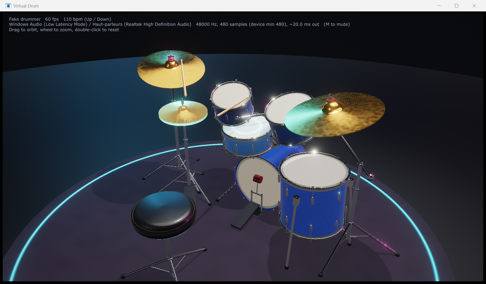

# Virtual Drum

Batterie virtuelle : deux baguettes équipées d'un IMU détectent les coups et envoient leurs données
par radio basse latence (Nordic ESB) à un récepteur USB, qui alimente une app native 3D + sampler.
Objectif : **latence geste → son < 10 ms** et un jeu expressif.



## Où en est-on (phase 0)
| Bloc | État |
|---|---|
| App host (JUCE) | vue 3D PBR du kit, sampler, batteur simulé, lecture du récepteur — tourne sur PC, build Mac en CI |
| Firmware baguette | IMU 1,66 kHz en FIFO → paquets RAW ESB — compile, **pas encore testé sur cible** |
| Firmware récepteur | ESB → USB CDC avec horodatage — compile, **pas encore testé sur cible** |
| Outils Python | logger CSV, tracés, parseur identique au C++ — testés en CI |

Ce qui attend le matériel et les réponses en suspens : [`QUESTIONS.md`](QUESTIONS.md).
Suivi des tâches : [`BACKLOG.md`](BACKLOG.md).

## Structure
```
firmware/   stick/ (baguette), receiver/ (récepteur USB), common/ (protocol.h, radio_config.h)
host/       app JUCE : vue 3D, sampler, vdrum_monitor, tests unitaires
tools/      Python : logger.py, plot_session.py, module vdrum (protocole)
docs/       architecture, hardware, protocole, décisions, roadmap, captures
```

## Démarrage rapide
- **App** : voir [`host/README.md`](host/README.md). Sans matériel : `"Virtual Drum.exe" --fake 120`.
- **Firmware** : voir [`firmware/README.md`](firmware/README.md). Les UF2 prêts à flasher sont publiés
  par la CI (onglet Actions → workflow *firmware* → artefacts).
- **Outils** : voir [`tools/README.md`](tools/README.md).

## Documentation
[Architecture](docs/ARCHITECTURE.md) · [Hardware](docs/HARDWARE.md) · [Protocole](docs/PROTOCOL.md) ·
[Décisions](docs/DECISIONS.md) · [Roadmap](docs/ROADMAP.md)

## CI
| Workflow | Contenu |
|---|---|
| `host` | build de l'app + tests unitaires, Windows et macOS |
| `tools` | pytest, Linux / Windows / macOS |
| `firmware` | build baguette gauche, baguette droite, récepteur (NCS v3.4.1), UF2 en artefacts |
